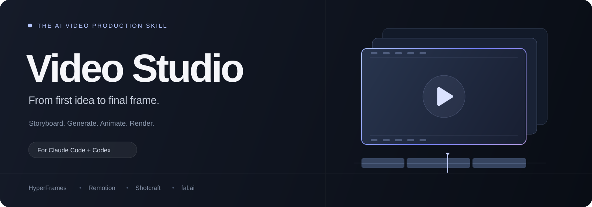

# Video Studio

A portable AI video production skill for **Claude Code and Codex**.

Turn a brief into a storyboard, generated assets, editable motion design, and a verified final video. One workflow selects the right tools for the job.

## Install

Ask your coding agent:

> Install the video-studio skill from https://github.com/BAKUGOS1/video-studio

Or use the community Skills CLI:

~~~sh
npx skills add BAKUGOS1/video-studio
~~~

Choose **video-studio**, your agent, and the installation scope when prompted. Refresh the agent session after installation if the skill is not listed yet.

### Claude Code

Invoke:

~~~text
/video-studio Create a 20-second product launch video using my screenshots.
~~~

### Codex

Invoke:

~~~text
$video-studio Create a 30-second explainer with editable source and an MP4.
~~~

### Claude web / Desktop

Download **video-studio.zip** from [the latest release](https://github.com/BAKUGOS1/video-studio/releases/latest). If your client offers custom Skill uploads, upload the ZIP and enable it.

If custom Skills are unavailable, add SKILL.md and the relevant references as Project knowledge, then say "Use video-studio". Project knowledge does not create a slash command. Rendering support depends on the tools available in that environment.

### Manual installation

Clone this repository, then copy its SKILL.md, references/ and agents/ into one of these folders:

| Client | Personal installation | Project installation |
| --- | --- | --- |
| Claude Code | ~/.claude/skills/video-studio/ | .claude/skills/video-studio/ |
| Codex | ~/.codex/skills/video-studio/ | .agents/skills/video-studio/ |

The entrypoint must be video-studio/SKILL.md. Keep references beside it. Custom CODEX_HOME setups should use their configured skills directory.

## What it combines

| Layer | Tool / reference | Purpose |
| --- | --- | --- |
| HTML motion | [HyperFrames](https://github.com/heygen-com/hyperframes) | HTML/CSS compositions and rendering |
| React motion | [Remotion skills](https://github.com/remotion-dev/skills) | Frame-based animation and editable React video |
| Product direction | [Video Shotcraft](https://github.com/Vincentwei1021/video-shotcraft) | Product shots, camera direction, beat-aware editing |
| Generated assets | [fal.ai community skills](https://github.com/fal-ai-community/skills) | Cinematic footage, story continuity, model execution |

The skill chooses **one renderer per composition**. Generated footage can be assembled using either renderer. Existing project choices and explicit user preferences take precedence.

This repository contains original orchestration instructions. It does not bundle upstream engines, shot libraries, music, or paid services. Relevant upstream guidance is loaded as needed.

## Example requests

~~~text
/video-studio Make a 15-second vertical promo from these screenshots.
Use a calm editorial style, no voiceover, and deliver editable source.
~~~

~~~text
$video-studio Plan a 30-second cinematic brand film.
Create the storyboard and shot prompts first. Do not spend API credits.
~~~

~~~text
/video-studio Edit my existing Remotion project.
Improve the pacing, add captions, and verify the final MP4.
~~~

You can describe the video in English, Hindi, or Hinglish.

## Workflow

1. Inspect the brief, actual assets, brand rules, and available tools.
2. Choose an engine and define shot timing.
3. Generate missing assets only when needed and within the authorized budget.
4. Build an editable composition and inspect a preview.
5. Render, check the actual file, and deliver video plus source.

If execution tools are unavailable, the skill delivers a script, storyboard, prompts, and an execution handoff instead of claiming to have rendered a video.

## Requirements and costs

- Planning and creative direction need only an agent that can read skill files.
- Rendering needs a compatible Node.js runtime and the selected engine's dependencies.
- fal.ai generation needs configured credentials and a funded account.
- Voice, stock, music, and hosted generation services may have separate costs and terms.
- Installing this skill does not install engines or grant provider access.
- Configure secrets through your provider or local environment; never paste API keys into issues.

## Files

~~~text
SKILL.md
agents/openai.yaml
references/
  engines.md
  direction.md
  sources.md
  portability.md
~~~

## Contributing

Open an issue for a reproducible workflow problem or a pull request with a focused improvement. Explain the target client, selected engine, expected result, and what you verified. Remove credentials and private assets from examples.

For instruction changes, check frontmatter, local reference links, and realistic routing. For tool commands or integrations, verify against current upstream documentation and record the actual check. No live generated-video benchmark is included in this release.

## License and acknowledgments

Original content in this repository is available under the [MIT License](LICENSE). Upstream tools and assets retain their own licenses and service terms. This project is independent and is not affiliated with or endorsed by HeyGen, Remotion, fal.ai, Anthropic, OpenAI, or Video Shotcraft.
